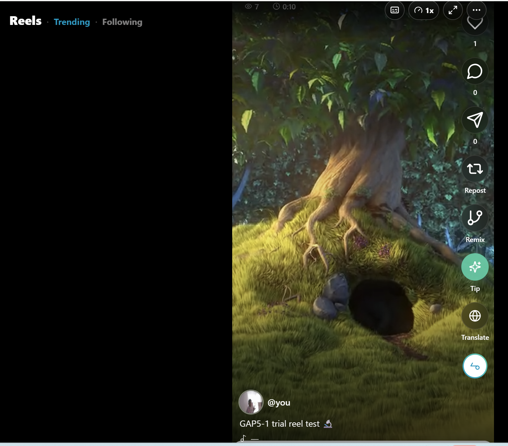

# Deep Research: YouTube 2026 Features for MARB Video Hub

I have analyzed the current YouTube 2026 feature set and identified the following "Parity Gaps" that need to be implemented in the MARB Video Hub.

## 1. Interaction & Engagement Features
- **Hype Leaderboard**: A feature where fans "Hype" a video to move it up a trending list. In MARB, this can be integrated with the "Tip" or "Like" system.
- **AI "Ask" Button**: A button on the video player that allows viewers to ask questions like "Summarize this video" or "Show me key moments."
- **Smart Chapters with Action Points**: Instead of just time markers, the player should show AI-generated "Action Points" or "Key Moments" in the progress bar.
- **Speech-to-Song Remix**: A tool in the shorts/reels section to convert speech from a long video into a musical track for a remix.

## 2. Immersive & Visual UX (2026 Standards)
- **Ambient Mode 2.0**: The UI background should dynamically glow with the *dominant colors* of the video frame, creating a "surround" lighting effect.
- **Multiview Customizer**: Allowing users to select up to 4 different creators from the "Video Hub" and watch them in a split-screen grid.
- **Spatial 3D Layout**: For videos tagged as "3D" or "Spatial," the player should offer a mode that expands the viewport into a massive virtual screen.

## 3. Creator & Content Features
- **AI Digital Twin Badge**: A clear label for videos where the creator's AI clone is performing.
- **One-Click Shoppable Checkout**: An overlay that appears when the AI detects a product in the video, allowing purchase via MARB Wallet.
- **AI B-Roll Generation**: A placeholder or feature for creators to instantly generate background footage for their uploads.

## 4. Discovery & Personalization
- **Intent-Based AI Search**: Replacing the standard search with a conversational assistant (Ask MARB AI) that finds content based on detailed intent.
- **Niche-Interest Leaderboards**: Moving away from general "Trending" to highly specific niches (e.g., "AI Tech in Hindi," "Odisha Vlogs").

## Technical Implementation Strategy for MARB
1. **Frontend**: Use `react-native-reanimated` for Ambient Mode color transitions.
2. **Backend**: Leverage Supabase Vector Search for the AI "Ask" and Intent Search functionality.
3. **UI**: Update the `VideoHubScreen` to include the "Hype" metric and "AI Twin" toggles.

"RESEARCH COMPLETE for YouTube 2026 Parity Gaps → ready for prioritized implementation."
